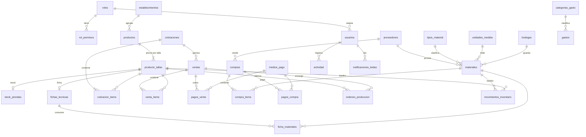

# PATYCA ERP — Backend

API REST en **Node.js + Express** sobre **PostgreSQL**. También sirve el front (`index.html`, `login.html`, `css/`, `js/`, `assets/`) desde el mismo puerto.

## Puesta en marcha

Requisitos: Node.js 20.6 o superior y PostgreSQL 14 o superior.

1. Crear una base vacía **en UTF8**:
   ```sql
   CREATE DATABASE patyca ENCODING 'UTF8' TEMPLATE template0;
   ```
2. Configurar:
   ```bash
   cd backend
   npm install
   cp .env.example .env    # completar DATABASE_URL, JWT_SECRET y ADMIN_*
   ```
3. Crear tablas, cargar datos iniciales y el usuario administrador:
   ```bash
   npm run db:init
   ```
4. Levantar el servidor y abrir http://localhost:3000:
   ```bash
   npm run dev
   ```

**Uso diario (sin modo desarrollo):** doble clic en `Iniciar PATYCA.bat` (carpeta raíz). Enciende el servidor y abre el navegador; mantener esa ventana abierta. Si se abre `login.html` o `index.html` con doble clic, la página redirige sola al servidor o indica que hay que iniciarlo. Requiere PostgreSQL instalado como servicio (se enciende solo con Windows).

**Versión portátil (para mostrar el sistema sin instalar nada):** `npm run portatil` crea la carpeta `../../PATYCA-portatil` con Node.js, PostgreSQL embebido y datos de demostración. Se comparte comprimida; quien la recibe la extrae (en una ruta corta, como el Escritorio) y hace doble clic en `Iniciar PATYCA.bat`.

`npm run db:reset -- --confirmar` borra **todo** y vuelve a ejecutar `db:init`.

`npm run db:demo` (con el servidor corriendo) carga datos de **prueba**: conteos de stock, compras, ventas, encargos, órdenes y gastos de las últimas semanas, más un usuario `bodega@patyca.cl` / `bodega1234`. Incluye 24 meses de historia para la proyección (solo la historia: `npm run db:demo -- --solo-historia`) y productos con **precio de prueba** para los colegios sin lista de precios (`--solo-catalogo`). Los clientes y ventas son inventados: no usarlo en la base real.

**Datos de prueba por SQL (Inicio, Producción y Proyección):** `db/demo-inicio-produccion.sql` se pega en el SQL Editor de Supabase (o `psql "$DATABASE_URL" -f db/demo-inicio-produccion.sql`). Carga ventas del mes, encargos, órdenes de producción, compras, gastos y 24 meses de historia por producto y talla para la proyección (solo si `ventas_historicas` está vacía), con fechas relativas al día en que se ejecuta. Todo queda marcado `[DEMO]` y se elimina con `db/demo-borrar.sql`. Para borrar solo las ventas de prueba (y su historia), dejando órdenes, compras y gastos: `db/borrar-ventas-simuladas.sql`.

## Estructura

```
backend/
├── db/
│   ├── schema.sql      Modelo relacional: tablas, restricciones, índices y vistas
│   └── seed.sql        Datos maestros reales (antes estaban en js/data.js)
├── scripts/db.js       db:init / db:reset
└── src/
    ├── server.js       Arranque
    ├── app.js          Rutas y permisos por módulo
    ├── config.js       Variables de entorno
    ├── db.js           Conexión y transacciones
    ├── lib/            Autenticación, errores, validación, kárdex/actividad
    └── routes/         Un archivo por módulo
```

## Reglas del modelo

- **No se guardan valores calculados.** Los totales, montos pagados, saldos y estados de pago (`Pendiente`, `Parcial`, `Pagada`) se calculan en las vistas `v_ventas`, `v_compras` y `v_cotizaciones`. Así nunca quedan desalineados con los pagos.
- **Los precios son por talla.** Hay una fila en `producto_tallas` por cada talla. La columna `grupo_precio` (por ejemplo `4-6-8`) conserva cómo se muestra la lista de precios.
- **Todo cambio de stock pasa por el kárdex** (`movimientos_inventario`). Esto incluye compras, ventas, anulaciones, conteos y producción.
- **Las operaciones van en transacciones.** Una venta descuenta stock y registra el pago en un solo paso. Si algo falla, no se guarda nada.
- **Los códigos legibles se generan en la base:**
  - `V-000001`, `C-…`, `COT-…`, `OP-…`, `PV-…`, `PC-…`, `G-…`, `MOV-…` salen del id del documento.
  - Los maestros usan un correlativo: `PR031`, `MAT-0010`, `EST-012`, `PROV-015`.
  - Los códigos de documentos pueden tener saltos: si una operación falla, el número que alcanzó a reservar no se reutiliza.
- **Los permisos están en la tabla `rol_permisos`**, no en el código. Las contraseñas se guardan con bcrypt.

## Flujos principales

- **Venta al mesón**: se descuenta el stock al registrarla. Si el cliente paga una parte, el resto queda por cobrar.
- **Encargo**: requiere nombre del cliente y queda "Por entregar" con su abono. **Al registrarlo se descuenta y reserva el stock disponible** (`venta_items.cantidad_reservada`, kárdex "Reserva de encargo"), así el stock muestra lo que realmente queda libre. Lo que falta se envía al taller (`enviar_taller: true` o desde su detalle; no se permite duplicar una orden abierta). Cuando el taller termina una orden del encargo, las prendas entran al stock y se reservan de inmediato para el cliente. Con todo reservado queda "Listo para retirar" (pendientes de Inicio). Al entregar no se mueve stock (salvo lo que faltara); al anular, lo reservado vuelve ("Liberación de reserva").
- **Producción**: Pendiente → En proceso → Terminada. Cada orden tiene fecha de entrega (si viene de un encargo, hereda la fecha de retiro). Se marca "Atrasada" o "Por vencer" según los días de aviso de Configuración. Al terminar, las prendas entran al stock y, si existe ficha de materiales, se descuentan los materiales.
- **Reposición** (`/inventario/reposicion`): sugiere cuánto comprar de cada material = stock objetivo (o mínimo) + lo que piden las órdenes abiertas según su ficha − stock actual. No compra nada por sí sola.
- **Compra**: suma stock de materiales y actualiza su último precio. Lo no pagado queda por pagar.
- **Cotizaciones** (menú Cotizaciones): ítems de texto libre (producto, cantidad, característica y precio unitario **neto**) para colegios, instituciones o empresas. `v_cotizaciones` calcula NETO, IVA 19 % y TOTAL. El PDF se arma en el navegador con jsPDF (`js/vendor/`, sin depender de internet) con encabezado, datos del emisor, SEÑORES, detalle, totales, cierre y firma; esos datos se editan en Configuración → Datos para cotizaciones. Bases creadas antes de este módulo: ejecutar `db/migracion-cotizaciones.sql` (no borra datos y se puede repetir).

- **Proyección** (`/proyeccion`): usa ~2 años de historia (`ventas_historicas` + ventas del sistema). Crecimiento = últimos 12 meses vs 12 anteriores; nivel de cada mes = promedio de los dos años (el reciente pesa el doble); proyección = nivel × (1 + crecimiento), valorizada a precio de lista actual. El simulador del front ajusta crecimiento, precios y demanda, y sugiere cuánto fabricar por talla (venta proyectada − stock − órdenes en curso).
- **Costo y rendimiento de tela** (vista `v_rendimiento_tela`, `GET /produccion/rendimiento-tela`): con el peso de la prenda por talla (marcado real o estimado) y los parámetros del tipo de tela (Algodón / Fantasía: precio por kg, peso del rollo, merma), igual que la planilla de PATYCA: consumo = peso × (1 + merma), costo = consumo × precio/kg, prendas por rollo y % del precio de venta. Cada orden muestra la tela que necesita y la proyección, los rollos a comprar.
- **Pesos reales**: `npm run db:pesos` importa `db/datos/pesos_uniformes.json`, extraído de `Pesos_uniformes_rendimiento_tela.xlsx` (celdas amarillas = estimadas).
- **Totales sin detalle** (tabla `ventas_resumen`, pestaña Ventas → Totales sin detalle): ventas registradas solo como monto del mes (opcionalmente por colegio). Suman en Inicio, finanzas y el gráfico de proyección, pero no en las unidades a fabricar. No deben duplicar ventas ya ingresadas una por una.
- **Resumen mensual** (`GET /finanzas/resumen-mes/:AAAA-MM`, menú Resumen mensual, solo con permiso de finanzas): generado (ventas registradas + historia + totales sin detalle), gastado (compras + gastos), resultado, flujo de caja (cobrado − pagado a proveedores − gastos) y comparación con el mes anterior; desglose por colegio, proveedor y categoría de gasto.
- **Total de gastos del mes**: gasto con `sin_detalle = true` y fecha el día 1 del mes (Compras y gastos → "+ Total de gastos del mes").
- **Historia previa al sistema**: se importa resumida por mes, producto y talla con `POST /proyeccion/historicas`.

Las cotizaciones tienen API pero no pantalla (módulo postergado).

## Diagrama entidad-relación



## Endpoints

Todas las rutas van bajo `/api`. Salvo `/auth/login` y `/salud`, todas exigen el encabezado `Authorization: Bearer <token>`.

| Módulo | Rutas |
|---|---|
| Sesión | `POST /auth/login`, `GET /auth/me` |
| Configuración | `GET/PUT /configuracion`, `PUT /tipos-tela/:id`, `GET /catalogos`, `POST/DELETE /catalogos/:catalogo[/:id]`, `GET/POST/PUT /usuarios`, `GET /roles` |
| Maestros | `GET/POST/PUT/DELETE` en `/establecimientos`, `/productos`, `/proveedores`, `/materiales` |
| Inventario | `GET /inventario/reposicion`, `GET /inventario/prendas`, `PUT /inventario/prendas/:productoId/:talla`, `PUT /inventario/materiales/:id`, `GET /inventario/movimientos` |
| Inicio | `GET /inicio` (resumen según los permisos del rol) |
| Ventas | `GET/POST/DELETE /ventas-resumen`, `GET/POST /ventas`, `GET/DELETE /ventas/:id`, `PATCH /ventas/:id/entregar`, `GET/POST /ventas/:id/pagos` |
| Cotizaciones | `GET/POST /cotizaciones`, `GET/PUT/DELETE /cotizaciones/:id`, `PATCH /cotizaciones/:id/estado`, `POST /cotizaciones/:id/venta` |
| Compras | `GET/POST /compras`, `GET /compras/referencia`, `GET /compras/:id`, `GET/POST /compras/:id/pagos` |
| Finanzas | `GET /finanzas/resumen-mes/:AAAA-MM`, `GET/POST /finanzas/gastos`, `DELETE /finanzas/gastos/:id`, `GET /finanzas/resumen` |
| Producción | `GET /produccion/rendimiento-tela`, `PATCH /produccion/fichas/:productoId/:talla/peso`, `GET /produccion/fichas`, `GET/PUT /produccion/fichas/:productoId/:talla`, `GET/POST /produccion/ordenes`, `GET/DELETE /produccion/ordenes/:id`, `PATCH /produccion/ordenes/:id/estado`, `PATCH /produccion/ordenes/:id/fecha` |
| Proyección | `GET /proyeccion`, `POST /proyeccion/historicas` |
| Reportes | `GET /reportes/ventas-mes`, `GET /reportes/ventas-mes/:AAAA-MM` (desglose por colegio, tipo de prenda y productos) |
| Otros | `GET /actividad`, `GET/POST/DELETE /notificaciones/leidas` |

Los errores siempre responden `{ "error": "mensaje" }` con el código HTTP correspondiente:

- `400`: dato inválido
- `401`: sin sesión
- `403`: sin permiso
- `404`: no existe
- `409`: conflicto, por ejemplo stock insuficiente o un registro con datos asociados
